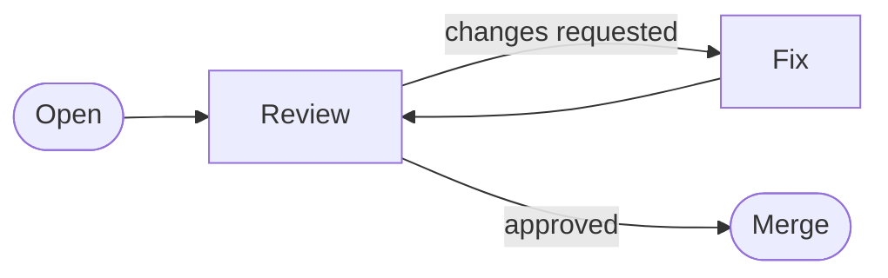

# miro-board-mcp

An MCP server that lets an agent turn a Markdown document into a Miro board: check it, preview it, and build it only after a person has said yes.

_Built in November 2026 with Claude Code as co-developer._

## Problem

A workshop board in Miro takes hours to lay out by hand. An agent can write the content quickly, but when it also writes coordinates, it gets them wrong: in the first two end-to-end runs of this server, an agent drew diagonal axes because it read line offsets as end points, and stacked four frames on top of each other because it read the frame spacing as a gap. And whatever an agent builds in Miro, it builds in a shared space that people work in.

## What it does

A board is one Markdown document. The server places every frame and element; the agent writes no coordinates.

| Markdown                                 | On the board                                |
| ---------------------------------------- | ------------------------------------------- |
| `# Title`                                | board name                                  |
| `## Heading`                             | one frame, in document order                |
| paragraphs, `###` sub-headings, quotes   | a text block at the top of the frame        |
| bullet or numbered list                  | one sticky note per item                    |
| ` ```mermaid ` block with `flowchart`    | shapes and connectors, laid out with dagre  |
| ` ```mermaid ` block with `wardley-beta` | a Wardley map; pipelines are drawn as bands |
| tables, images, other code               | not drawn; validation names the line        |

The same document renders in any Markdown viewer that supports Mermaid, so the source stays readable without Miro.

| Tool             | What it does                                                                                                                                                            |
| ---------------- | ----------------------------------------------------------------------------------------------------------------------------------------------------------------------- |
| `validate_board` | Checks a document without building anything: errors and warnings with their Markdown line, texts that will not fit, elements outside their frame. Read-only.            |
| `preview_board`  | Runs the real builder against a dry-run transport: frames in build order with position, size and element count, Miro API calls, estimated time, and a `spec_hash`.      |
| `build_board`    | Builds on a new board, or on an existing board from an allowlist. `dry_run` is true by default; writing needs `dry_run: false` and the `confirm_hash` from the preview. |
| `list_frames`    | Lists the frames of an allowed board with position and size, to check the result.                                                                                       |

| Resource               | Content                                                      |
| ---------------------- | ------------------------------------------------------------ |
| `board-doc://guide`    | the document format, the supported Mermaid syntax, the rules |
| `board-doc://example`  | a complete, valid board document for a fictional workshop    |
| `board-spec://schema`  | advanced: JSON Schema of the generator's YAML format         |
| `board-spec://example` | advanced: the same workshop as a YAML spec with coordinates  |

| Prompt              | Arguments                                                            | Does                                                                              |
| ------------------- | -------------------------------------------------------------------- | --------------------------------------------------------------------------------- |
| `workshop_to_board` | `topic`, `duration_minutes`, `participants?`, `learning_objectives?` | guide → document → validate → preview → ask → build after the user's explicit yes |

All tools also take an optional `spec` parameter instead of `document`: a YAML spec with exact coordinates, for the rare board that needs them.

## Example

From [examples/code-review-basics.md](examples/code-review-basics.md), a fictional 45-minute workshop:

````markdown
## From pull request to merge


````

`preview_board` on the whole document:

```text
Preview of "Code Review Basics": 6 frames, 49 elements (incl. 6 title bars), 9 connectors, 64 Miro API calls (about 42 s).
1. Code Review Basics: 2 elements incl. title bar, 1600 x 900 at (800, 450)
2. Welcome: 5 elements incl. title bar, 1600 x 900 at (2700, 450)
...
5. Where our review practice stands: 25 elements incl. title bar, 1920 x 1280 at (8560, 640)
spec_hash: sha256:2daefb10...
Show this list to the user. Only after the user confirms, call build_board with dry_run: false and confirm_hash set to spec_hash.
```

A mistake comes back with its line and the fix:

```text
Invalid: 1 error.
- line 7: wardley-beta could not read "component Zugänge [0.3, 0.7]": unexpected character: ->ä<-.
  A name with umlauts or one of : , ? needs double quotes, e.g. component "Zugänge" [0.30, 0.70].
```

## Safety

The server writes to a shared workspace on behalf of a model, so every write is gated:

- **A person approves every write.** `build_board` is a dry run unless called with `dry_run: false` and the `spec_hash` that `preview_board` returned for exactly this document. Any change after the preview changes the hash.
- **Only allowed boards.** It creates new boards, and touches existing ones only if their ids are in `MIRO_MCP_ALLOWED_BOARD_IDS` (or it created them in this process). It cannot delete or change anything that exists.
- **Limits.** Input size, frames, elements, API calls per build, builds per process and build time are capped; a build stops between frames on cancellation and at once on 401, 403 or 404, and returns what exists.
- **Secrets.** The Miro token comes only from the environment, is never logged and never appears in a result.
- **No external content.** Images and embeds need an https host from `MIRO_MCP_ALLOWED_URL_HOSTS` (none by default); YAML `!include` is off; alias bombs are stopped before parsing.
- **stdio discipline.** stdout carries JSON-RPC only; all logging goes to stderr.

The reasoning behind each of these is in [docs/design.md](docs/design.md).

## Quick start

Requires Node.js 22.18 or later.

```bash
git clone --recurse-submodules <this repository>
cd miro-board-mcp
npm install
npm run build
npm test
```

[miro-board-builder](https://github.com/andreasschliep/miro-board-builder), the generator this server builds on, is a git submodule in `vendor/`, pinned to one commit. If you cloned without `--recurse-submodules`, run `git submodule update --init` before `npm install`.

Validation and preview need no token and no network. Try them with the MCP Inspector:

```bash
npx @modelcontextprotocol/inspector --cli node dist/server.js --method tools/list
```

### Configuration

Copy [.env.example](.env.example) and set the variables in the environment of the server process:

| Variable                     | Needed for                                   |
| ---------------------------- | -------------------------------------------- |
| `MIRO_ACCESS_TOKEN`          | `build_board`, `list_frames`                 |
| `MIRO_TEAM_ID`               | optional: team for new boards                |
| `MIRO_MCP_ALLOWED_BOARD_IDS` | optional: existing boards the server may use |
| `MIRO_MCP_ALLOWED_URL_HOSTS` | optional: hosts for images and embeds        |

With 1Password, keep only a reference in an env file (`MIRO_ACCESS_TOKEN=op://Vault/Item/field`) and start the server through `op run --no-masking --env-file=...`; `--no-masking` keeps stdio untouched. Claude Code waits 30 seconds for a server to start; set `MCP_TIMEOUT=120000` if the 1Password approval takes longer.

### Claude Code

```bash
claude mcp add miro-board --scope user -- node /absolute/path/to/miro-board-mcp/dist/server.js
```

Then ask: "Create a Miro board for a 60-minute retrospective", or run the prompt template from the `/` menu.

### Claude Desktop

In `claude_desktop_config.json`, with absolute paths (Claude Desktop does not use your shell's `PATH`), here with the token from 1Password:

```json
{
  "mcpServers": {
    "miro-board": {
      "command": "/opt/homebrew/bin/op",
      "args": [
        "run",
        "--no-masking",
        "--env-file=/absolute/path/to/.env.op",
        "--",
        "/opt/homebrew/bin/node",
        "/absolute/path/to/miro-board-mcp/dist/server.js"
      ]
    }
  }
}
```

The tools then appear in the tools menu of a new chat.

## Limits

- Frames are placed in one row; inside a frame, blocks stack from the top. There is no free placement in a document; use `spec` for that.
- Mermaid support covers `flowchart` and `wardley-beta`. Flowcharts are parsed by the official `mermaid` package, which needs a DOM in Node; a jsdom window provides it, at the cost of about 130 MB of dependencies.
- `evolve` on a part of a pipeline is not drawn, because Mermaid does not draw it either.
- The server never updates or deletes existing items. A second build adds a second copy.
- Miro's rate limit makes large boards slow: about 0.65 seconds per item.

## How this was built

What existed before: [miro-board-builder](https://github.com/andreasschliep/miro-board-builder), my generator that builds a Miro board from a YAML description through the REST API.

What is new: this MCP server, built in November 2026. It started with the generator's YAML as input. Three end-to-end runs with an agent and a fault test with 20 deliberate mistakes shaped it: the coordinate errors of the first two runs led to layout warnings and then to Markdown with Mermaid as the input, so that the server computes every position; the fault test led to findings that name the line of their cause. The generator gained two library options (no `!include` for untrusted input; stop on cancellation and on fatal Miro errors) and schema descriptions.

Claude Code was co-developer: it drafted much of the code, the tests and the documentation, and ran the end-to-end tests in separate sessions. I defined the problem, decided the design ([docs/design.md](docs/design.md)), reviewed every phase before the next one started, and approved every write to Miro.

## Licence

MIT, see [LICENSE](LICENSE).

## Related tools

- [miro-board-builder](https://github.com/andreasschliep/miro-board-builder): describe a Miro board in YAML and build it through the REST API (the generator this server builds on)
- [wardley-map-builder](https://github.com/andreasschliep/wardley-map-builder): render Wardley maps from YAML to PNG or onto a Miro board
