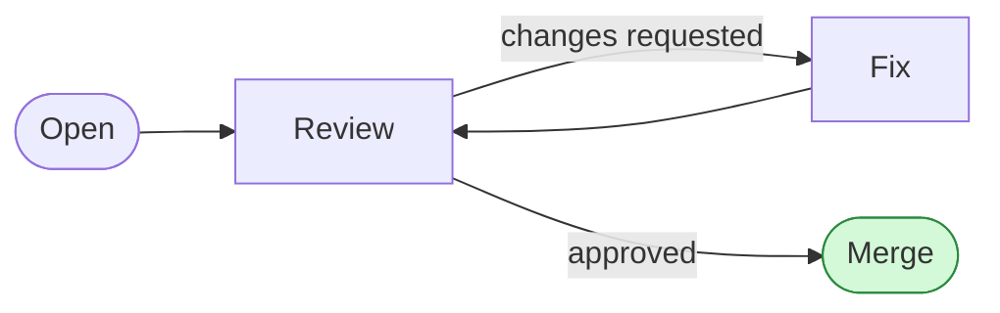

# Code Review Basics

A fictional 45-minute workshop for a development team. Everything on this board is invented.

## Welcome

**What makes a review helpful for you?** Write one sticky per prompt.

- A review that taught me something ...
- A review that annoyed me ...
- What I look at first ...

## What to check

- Correctness: does it do what the ticket says?
- Edge cases covered by tests?
- Names say what things are
- One idea per function
- No secrets in code
- Inputs checked at the boundary

## From pull request to merge



## Where our review practice stands

```mermaid
wardley-beta
title Where our review practice stands
anchor Team [0.95, 0.55]
component Helpful feedback [0.80, 0.45]
component Review checklist [0.55, 0.40]
component Linting [0.30, 0.85]
component Pairing [0.45, 0.20]
Team -> Helpful feedback
Helpful feedback -> Review checklist
Helpful feedback -> Pairing
Review checklist -> Linting
evolve Review checklist 0.70
note "automate what a checklist repeats" [0.25, 0.55]
```

## Commitments

What will you try in your next review?

- One question instead of one instruction
- Review within a day
- Praise one thing that works
