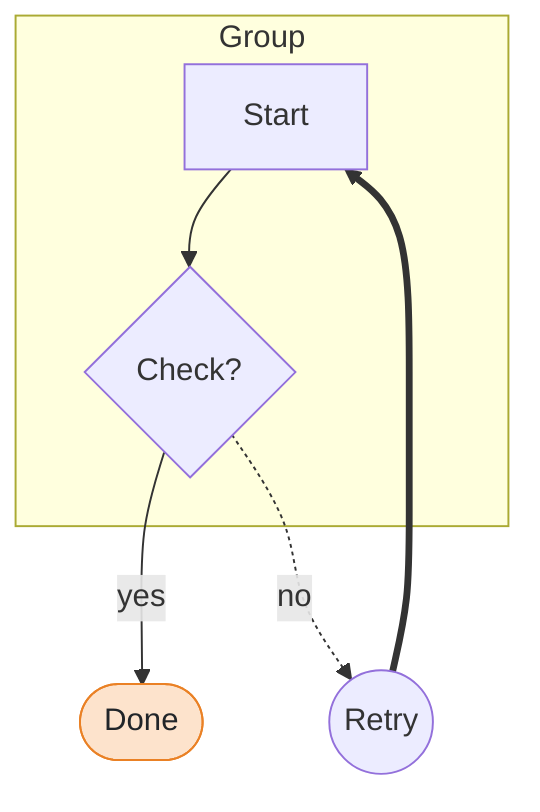

Intro text before the first frame, with a [link](https://example.com/a).

## Text and quotes

A paragraph with **bold**, *italic*, ~~struck~~ and `code`.

### A sub-heading

> A quote that stands alone.

> First quote
> on two lines

## Lists

- Plain item
- Item with a nested list
  - nested one
  - nested two
1. Ordered one
2. Ordered two

- [ ] Open task
- [x] Done task
- Plain after tasks

## Only a quote

> One sentence that is the whole frame.

## Flowchart with subgraph



Text after the diagram.

## Map

```mermaid
wardley-beta
anchor User [0.95, 0.5]
component Answers [0.8, 0.5]
component Search [0.4, 0.7]
User -> Answers
Answers -> Search
evolve Search 0.9
```
